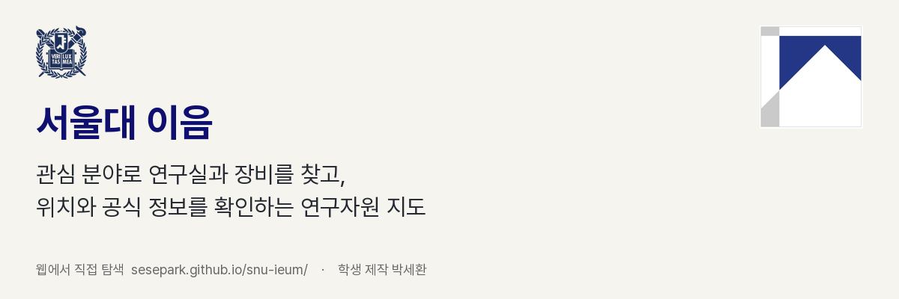

<p align="center">
  
</p>

<p align="center">
  <a href="https://sesepark.github.io/snu-ieum/">웹에서 직접 체험하기</a> ·
  <a href="https://github.com/sesepark/snu-ieum/raw/refs/heads/main/docs/readme/demo-64s.mp4">64초 시연 영상</a> ·
  <a href="#실제-탐색-사례">사용 사례</a> ·
  <a href="#chatgpt-edu-활용">ChatGPT Edu 활용</a> ·
  <a href="#수록-범위와-검증">수록 범위와 검증</a>
</p>

**서울대 이음**은 관심 분야로 서울대의 **연구실·교수·장비·공간**을 찾고, 위치와 공식 정보를 이어서 확인하는 연구자원 지도입니다. 연구실 이름이나 소속 학과를 몰라도 탐색을 시작할 수 있습니다.


**바로 해보기:** [웹 체험](https://sesepark.github.io/snu-ieum/) → `시계열` 검색 → 데이터과학 및 비즈니스 애널리틱스 연구실 선택 → **39동 411호**와 공식 소개 확인.

로그인이나 AI 키 없이 탐색할 수 있습니다. 현재 공개 화면은 **사람 승인 전 데이터로 동작하는 공모전 시연**입니다. 제작: 박세환. 서울대학교 공식 운영 서비스는 아닙니다.

## 어떤 문제를 해결하나요

연구 주제가 있어도 어느 학과와 연구실에서 관련 연구를 하는지 찾기 어렵습니다. 교수·연구실 소개, 장비의 용도와 설치 장소가 서로 다른 홈페이지에 나뉘어 있기 때문입니다.

| 하고 싶은 일 | 직접 찾아볼 때 | 이음에서 |
| --- | --- | --- |
| 관심 분야의 연구실 찾기 | 관련 학과를 찾고 여러 소개 확인 | 주제로 검색하고 유형·학과로 범위 좁히기 |
| 장비의 설치실 확인 | 장비 주소와 캠퍼스 지도를 다시 대조 | 장비에서 공식 설치 관계를 따라 장소 열기 |
| 정보의 근거 확인 | 검색 설명과 원문을 따로 맞추기 | 소개·주소·관계에 붙은 공식 출처 열기 |

## 실제 탐색 사례

### 시계열 연구실의 분야와 주소 확인

`시계열` 검색은 교수·연구실 후보 **5개**를 반환합니다. 데이터과학 및 비즈니스 애널리틱스 연구실에서 시계열 표상 학습·이상치 탐지·예측 분야와 **39동 411호**를 확인할 수 있습니다.

[산업공학과 공식 연구실 소개](https://ie.snu.ac.kr/dsba_lab/)

### 초저온 장비에서 설치실로 이동


`초저온` 검색에서 **300kV Cryo-EM**을 선택해 용도와 **139-1동 B112호**를 확인합니다. 공식 설치 관계를 따라 공간 상세로 이동하고, **이용 안내**에서 운영기관의 절차를 읽을 수 있습니다.

[공식 장비 상세](https://irf.snu.ac.kr/possessed_device/possessed_device.php?idx=105) · [공동기기원 이용절차](https://irf.snu.ac.kr/information_use/usage_procedure.php)

설치 장소가 있다는 사실은 이용 자격이나 예약 가능 여부를 뜻하지 않습니다.

### 여러 학과의 로봇 연구자원 탐색


`로봇` 후보 **18개**는 기계·전기정보·조선해양·항공우주 **4개 학과**에 분포합니다. 이 중 **9개 자원**은 **5개 건물**에서 위치를 확인할 수 있고, 나머지 9개는 목록에서 탐색합니다. 같은 주제나 가까운 거리를 협업 관계로 표시하지 않습니다.

### 모바일에서도 이어지는 탐색

<table>
  <tr>
    <td width="72%" valign="top"><p><strong>데스크톱</strong><br />지도와 목록을 함께 보고 2D·3D에서도 같은 선택과 필터를 이어갑니다.</p></td>
    <td width="28%" valign="top"><p><strong>모바일</strong><br />검색·목록과 지도를 전환합니다. 상세를 닫으면 이전 검색 목록으로 돌아갑니다.</p></td>
  </tr>
</table>

[64초 실제 조작 영상 보기 · MP4](https://github.com/sesepark/snu-ieum/raw/refs/heads/main/docs/readme/demo-64s.mp4)

## ChatGPT Edu 활용

서울대 **ChatGPT Edu의 Codex**로 요구사항 정리, 공식 정보 구조화, 검색·지도 구현, 실행 후 수정과 검사를 진행했습니다. 사람이 탐색 대상과 출처 기준을 정하고 화면을 검토했습니다.

| 사용 과정 | 결과와 확인 근거 |
| --- | --- |
| 탐색 흐름 정리 | 관심 분야 → 유형·학과 → 결과 → 위치·공식 정보 |
| 공식 자료 연결 | 분야·주소·이용 안내를 출처와 함께 기록하고 교수실과 연구실을 구별 |
| 화면 실행과 수정 | 검색 변경 시 이전 상세 해제, 중복 시작 버튼 정리, 검색 위치 강조, 모바일 목록 복귀 |
| 기능·데이터 확인 | 타입 검사·단위/API·브라우저 검사와 공식 출처·중복 후보 대조를 별도로 기록 |

[검색·탐색 구현](https://github.com/sesepark/snu-ieum/commit/900f31d) · [공식 정보와 위치 대조](data/campus/representative-facts-ingestion-20261031.json) · [상세 행동과 위치 검사](https://github.com/sesepark/snu-ieum/commit/d150b4b)

ChatGPT Edu는 **개발 과정**에 사용했습니다. 공개 시연의 일반 검색과 지도는 외부 AI 응답 없이 동작합니다. 서비스 내부의 선택적 AI 목표 해석은 별도 연동으로, 실계정 검증 전 비활성 상태입니다.

## 수록 범위와 검증

2026년 **10월 31일** 데이터·화면 기준입니다. 공대 12개 학과와 공용시설부터 수록했으며, 캠퍼스 전체 건물 배경이 서울대 전체 연구자원 수록을 뜻하지는 않습니다.

| 교수 | 연구실 | 장비 | 공간 | 합계 |
| ---: | ---: | ---: | ---: | ---: |
| 341명 | 237곳 | 209개 | 45곳 | 832개 후보 |

- 출처가 있는 관계 **294개**, 화면 논문 근거 **16건**입니다. 논문은 독립 자원으로 세지 않습니다.
- 필수 정보·위치를 추가 점검할 자원 **450개**, 같은 이름 후보 **8묶음**을 기록했습니다. 모델·식별자·공식 URL이 다른 자원을 이름만으로 합치지 않았습니다.
- 전체 자원 중 지도 위치 근거가 있는 자원은 **309개**입니다. 위치 배치 수와 추가 점검 대상 수는 서로 다른 집계입니다.
- **기능 검사:** Node 24 타입 검사, 단위/API **102개**, Chrome 브라우저 **17개**, 빌드 통과.
- **아직 수행하지 않은 검증:** 사람의 데이터 공개 승인, 실제 학생 시간 절감·성공률 평가, 정식 운영·복구 검증.

여러 홈페이지를 오가며 주제와 자원·주소를 맞추는 부담을 줄일 것으로 기대합니다. 실제 학생 효과는 측정한 뒤 공개합니다. 저장·실행 보드·로그인은 후속 범위입니다.

[대표 검색·데이터 검증](review/contest-202610/verified-data-20261031.json) · [추가 점검 목록](review/current-quality-audit.json) · [중복 후보 대조](review/contest-202610/duplicate-review-20261031.json) · [수집·접근 상태](data/campus/source-recheck-20261031.json) · [평가 절차](review/evaluation/PROTOCOL.md)

## 직접 실행하기

**Node.js 24**가 필요합니다. 기본 웹은 저장소의 검수 초안으로 실행되며 DB·AI 키 없이 탐색할 수 있습니다.

```bash
git clone https://github.com/sesepark/snu-ieum.git
cd snu-ieum
npm ci
npm run dev
```

`http://127.0.0.1:5173/snu-ieum/`을 엽니다. API·배치 설정과 운영은 [실행 안내](CONTRIBUTING.md)를 따릅니다.

<details>
<summary>개발 구조와 검사 명령</summary>

| 영역 | 구성 |
| --- | --- |
| 웹 | React · TypeScript · Vite · Zustand · TanStack Query |
| 지도 | Three.js · Canvas · 2D/3D 탐색 |
| API·수집 | Node.js 24 · Fastify |
| 데이터 | PostgreSQL · pgvector · pg_trgm |
| 계약·검증 | Zod · Vitest · Playwright |

```bash
npm run check
npm test
PLAYWRIGHT_CHANNEL=chrome npm run test:e2e
npm run build
```

[제품 명세](IMPLEMENTATION.md) · [협업·실행 안내](CONTRIBUTING.md) · [운영 안내](infra/OPERATIONS.md)

</details>

## 위치와 출처를 다루는 원칙

공식 근거가 없는 위치는 지도에 임의 배치하지 않습니다. 개인 연락처를 표시하거나 이용 자격을 추정하지 않으며 자동 이메일·신청·예약을 수행하지 않습니다. 원문이 바뀔 수 있으므로 실제 이용 전 공식 안내를 확인합니다.

캠퍼스 공간 배경은 [OpenStreetMap](https://www.openstreetmap.org/copyright)과 Copernicus GLO-30 DSM을 사용합니다. 약 30m DSM과 개략 건물 높이는 정밀 측량·실내 안내가 아닙니다. [서울대학교 공식 UI 원본·색상 안내](apps/web/public/identity/SOURCES.md)를 따르며, 정장과 SNU Pattern은 원본 비례·색상을 유지해 사용합니다.
