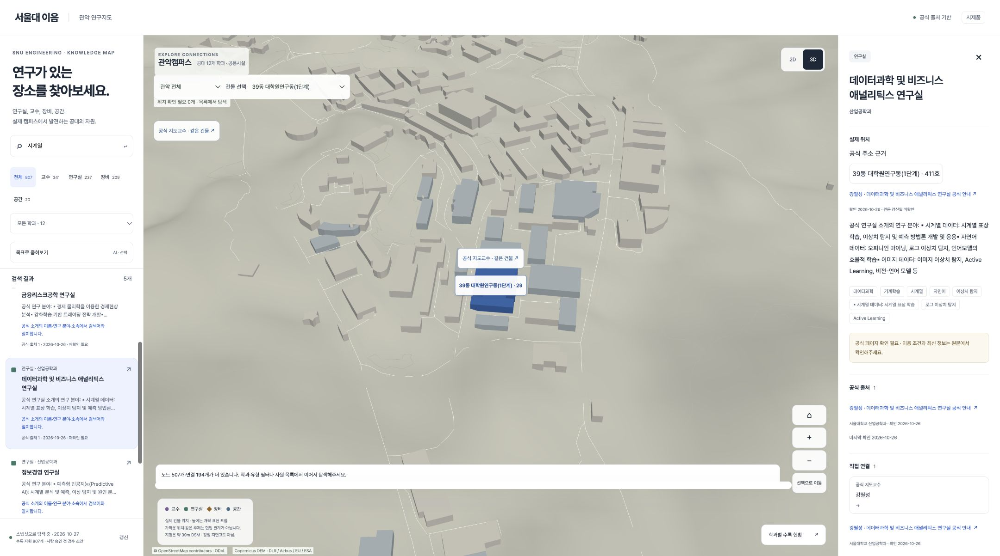
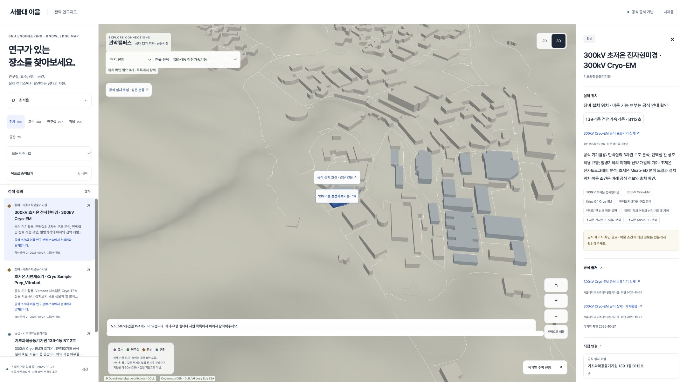
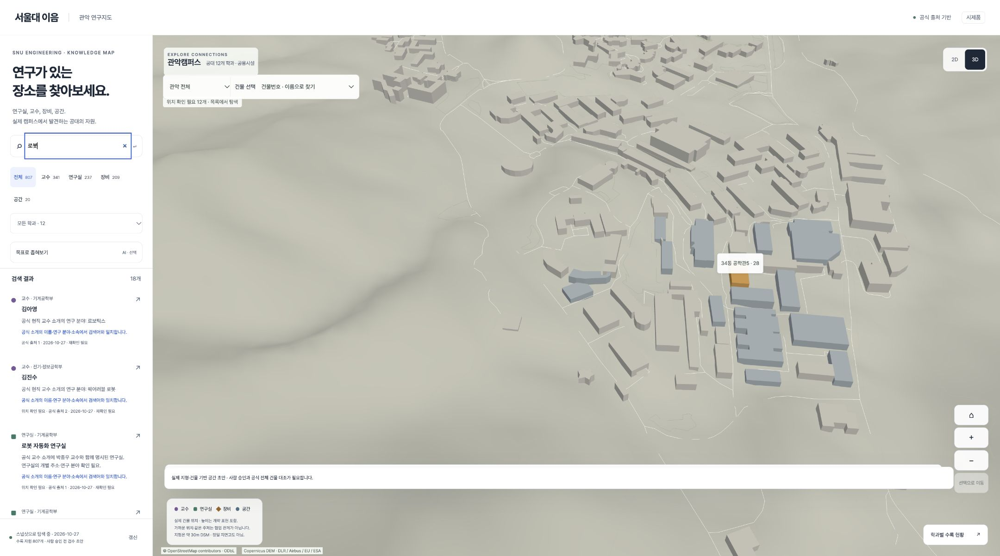
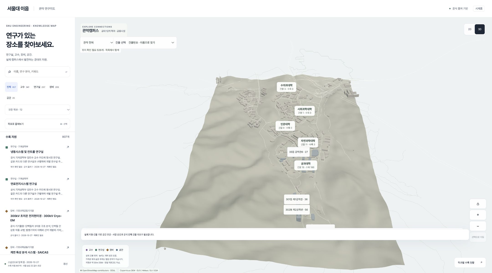
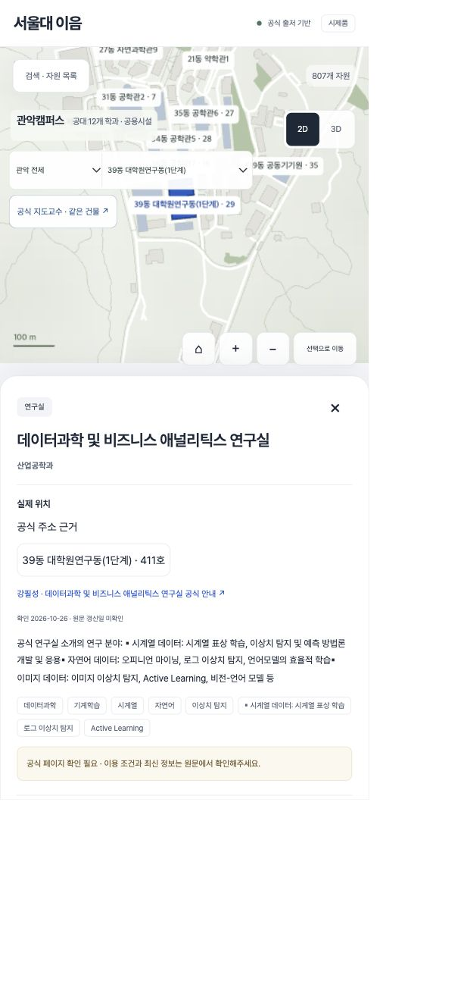

<p align="center">
  
</p>

<p align="center">
  <a href="#핵심-기능">핵심 기능</a> ·
  <a href="#실제-화면으로-보기">실제 화면</a> ·
  <a href="https://github.com/sesepark/snu-ieum/raw/refs/heads/main/docs/readme/demo-64s.mp4">64초 시연 영상</a> ·
  <a href="#직접-실행하기">직접 실행</a> ·
  <a href="#구현과-검증-범위">검증 기록</a>
</p>

**서울대 이음**은 관심 분야로 서울대의 **연구실·교수·장비·공간**을 찾고, 실제 위치와 공식 원문까지 확인하는 연구자원 탐색 서비스입니다. 연구실 이름이나 소속 학과를 몰라도 탐색을 시작할 수 있도록 만들었습니다.



<p align="center"><sub>실제 시제품 화면 · 시계열 검색 → 연구실 선택 → 39동 411호와 공식 소개 확인</sub></p>

> **현재는 공개 서비스 배포 전 시제품입니다.** 화면과 영상은 2026년 10월 27일 구현 기준이며, 수록 자료는 사람 승인 전 검수 초안입니다. 학생의 시간 절감·탐색 성공률은 아직 측정하지 않았습니다.

## 핵심 기능

| 관심 분야로 발견 | 실제 장소로 연결 | 공식 근거로 확인 |
| :--- | :--- | :--- |
| 주제 검색과 학과·자원 유형 필터로 관련 후보를 찾습니다. | 실제 관악캠퍼스 2D·3D 지도에서 건물별 자원을 탐색합니다. | 자원 소개·주소·공식 관계의 출처를 직접 열어 확인합니다. |

“로봇을 연구하는 곳은 어느 학과에 있을까?”, “시계열 연구실은 어느 건물에 있을까?”라는 질문에서 출발했습니다. 학과 홈페이지의 연구 소개와 운영기관의 장비·설치 정보를 하나의 탐색 흐름으로 연결합니다.

## 실제 화면으로 보기

### 01 연구실 이름을 몰라도 관심 분야로 찾기

`시계열`을 검색하면 교수·연구실 후보 5개가 반환됩니다. 데이터과학 및 비즈니스 애널리틱스 연구실을 선택하면 연구 분야와 **39동 411호**, 해당 주소를 확인한 공식 소개를 함께 볼 수 있습니다.

[연구실의 공식 소개 확인하기](https://ie.snu.ac.kr/dsba_lab/)

### 02 장비에서 공식 설치실까지 탐색하기



`초저온` 검색에서 **300kV Cryo-EM**을 선택해 장비 용도와 **139-1동 B112호** 설치 근거를 확인합니다. 공식 설치 관계를 따라 해당 공간의 상세로 이동할 수 있습니다.

[장비의 공식 상세 확인하기](https://irf.snu.ac.kr/possessed_device/possessed_device.php?idx=105)

설치 장소는 이용 허가나 예약 가능 여부를 뜻하지 않습니다. 실제 이용 절차와 최신 조건은 운영기관에서 확인합니다.

### 03 다른 학과의 연구자원도 같은 주제로 보기



`로봇` 검색으로 **기계·전기정보·조선해양·항공우주 4개 학과의 후보 18개**를 함께 살펴볼 수 있습니다. 학과와 유형으로 범위를 좁힌 뒤 각 자원의 공식 소개와 위치를 확인합니다. 검색 동시 출현이나 지도상의 거리를 실제 협업 관계로 표시하지 않습니다.

### 04 데스크톱과 모바일에서 같은 근거 확인하기

<table>
  <tr>
    <td width="72%" valign="top">
      
      <p><strong>데스크톱</strong><br />3D 캠퍼스와 검색 목록을 함께 탐색합니다. 2D로 전환해도 자원·필터·선택을 이어갑니다.</p>
    </td>
    <td width="28%" valign="top">
      
      <p><strong>모바일</strong><br />2D 지도를 기본으로, 검색 목록과 하단 상세에서 같은 자원과 출처를 확인합니다.</p>
    </td>
  </tr>
</table>

[64초 실제 화면 시연 보기 · MP4](https://github.com/sesepark/snu-ieum/raw/refs/heads/main/docs/readme/demo-64s.mp4)

영상은 실제 시제품 화면을 0.5초 간격으로 기록한 시연입니다. 학생 사용성 실험 영상은 아닙니다. 위 후보 수는 현재 검색의 반환 수이며, 관련도 평가 통과 수가 아닙니다.

## ChatGPT Edu와 함께 개발한 과정

서울대 **ChatGPT Edu의 Codex**를 활용해 요구사항 정리, 공식 정보 연결, 검색·지도 구현, 실행 후 수정과 검증을 진행했습니다. 사람이 탐색 대상과 출처 기준을 정하고 실제 실행 화면을 검토했습니다.

| 실제로 발견한 불편 | 개선한 동작 | 변경 기록 |
| --- | --- | --- |
| 검색어를 바꿔도 이전 자원의 상세가 남음 | 검색·필터 변경 시 이전 선택 해제 | [5f99bd1](https://github.com/sesepark/snu-ieum/commit/5f99bd1) |
| 위치가 긴 공식 설명 아래에 묻힘 | 위치와 주소 근거를 상세 상단에 배치 | [64eda2f](https://github.com/sesepark/snu-ieum/commit/64eda2f) |

일반 검색과 지도는 AI 응답 없이 작동합니다. 서비스 내부의 선택적 목표 해석은 별도 Gemini 연동으로, 실계정 검증 전에는 비활성입니다.

## 구현과 검증 범위

2026년 10월 27일 고정한 코드·데이터 기준입니다. 현재 자료는 **공대 12개 학과와 공용시설**에서 시작하며, 캠퍼스 전체 건물 배경이 서울대 전체 연구자원 수록을 뜻하지는 않습니다.

| 수록 초안 | 교수 | 연구실 | 장비 | 공간 |
| --- | ---: | ---: | ---: | ---: |
| 자원 후보 807개 · 사람 승인 전 | 341명 | 237곳 | 209개 | 20곳 |

- **구현:** 주제 검색, 학과·유형 필터, 건물별 탐색, 2D·3D 전환, 공식 관계·출처, 모바일 탐색.
- **기능 검사:** 타입 검사, 단위/API 96개, Chrome 브라우저 13개, 빌드 통과.
- **남은 검증:** 대표 데이터와 위치의 사람 검수, 검색 관련도·학생 평가, 공개 배치 승인, 실제 운영·복구.
- **후속 기능:** 저장·실행 보드·로그인.

[검증 근거](review/contest-202610/evidence.json) · [대표 검색 사례](review/contest-202610/demo-cases.json) · [평가 절차](review/evaluation/PROTOCOL.md) · [구현 현황](review/campus/IMPLEMENTATION-STATUS.md)

## 직접 실행하기

**Node.js 24**가 필요합니다. 기본 웹은 저장소의 807개 자원 검수 초안 스냅샷으로 실행되며, DB·AI 키·계정 로그인 없이 탐색할 수 있습니다. 데이터는 사람 승인 전 시제품 자료입니다.

```bash
git clone https://github.com/sesepark/snu-ieum.git
cd snu-ieum
npm ci
npm run dev
```

브라우저에서 `http://127.0.0.1:5173/snu-ieum/`을 엽니다. 포트가 사용 중이면 터미널에 표시된 Local 주소를 사용합니다. API·배치 설정과 운영 방법은 [실행 안내](CONTRIBUTING.md)를 따릅니다.

<details>
<summary>개발 구조와 검사 명령</summary>

| 영역 | 구성 |
| --- | --- |
| 웹 | React · TypeScript · Vite · Zustand · TanStack Query |
| 지도 | Three.js · Canvas · 2D/3D 탐색 |
| API·수집 | Node.js 24 · Fastify |
| 데이터 | PostgreSQL · pgvector · pg_trgm |
| 계약·검증 | Zod · Vitest · Playwright |

```bash
npm run check
npm test
PLAYWRIGHT_CHANNEL=chrome npm run test:e2e
npm run build
```

[제품 명세](IMPLEMENTATION.md) · [협업·실행 안내](CONTRIBUTING.md) · [운영 안내](infra/OPERATIONS.md)

</details>

## 위치와 출처를 다루는 원칙

공식 근거가 없는 위치는 지도에 임의 배치하지 않습니다. 개인 연락처를 표시하거나 이용 자격을 추정하지 않으며, 자동 이메일·신청·예약을 수행하지 않습니다. 원문이 바뀔 수 있으므로 실제 이용 전 공식 안내를 확인합니다.

캠퍼스 공간 배경에는 [OpenStreetMap](https://www.openstreetmap.org/copyright)과 Copernicus GLO-30 DSM을 사용합니다. 지도에서 가깝다는 사실과 공식 관계를 구별하며, 약 30m DSM의 지형과 건물 높이는 정밀 측량·실내 안내가 아닙니다. 자세한 수집 범위와 원자료 조건은 [캠퍼스 구현 계획](review/campus/PLAN.md)과 [제품 명세](IMPLEMENTATION.md)를 따릅니다.
